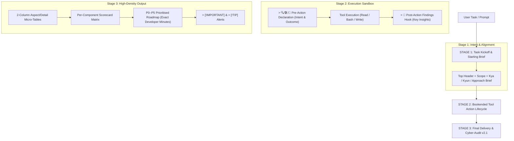

<div align="center">

# 🛡️ Agent Guardrails & Claude Opus 3-Stage Lifecycle

**Enterprise execution guardrails, Claude Opus cognitive demeanor, 3-Stage Communication Lifecycle, Cyber-Audit v2.1 layout, and Hookify runtime safety for AI Agent IDEs.**

<p align="center">
  <a href="LICENSE"></a>
  <a href="#"></a>
  <a href="#"></a>
  <a href="#"></a>
  <a href="#"></a>
</p>

<p align="center">
  <b>Eliminate runaway speculative loops • Bookend every tool action • Eradicate AI sycophancy & slop • Deliver high-density Cyber-Audits</b>
</p>

---

### 🏷️ GitHub Topics & Tags
`antigravity-ide` • `claude-opus` • `claude-sonnet` • `ai-guardrails` • `agentic-coding` • `developer-tools` • `prompt-engineering` • `llm-safety` • `anti-slop` • `cyber-audit` • `hookify` • `pair-programming`

</div>

---

## ⚡ The Problem vs. The Solution

| Default Agent Behavior ❌ | With Agent Guardrails & 3-Stage Lifecycle ✅ |
| :--- | :--- |
| Runs speculative runaway loops and exploratory command spam. | **Atomic & Purposeful Execution:** Strictly maximum 1 command per turn with immediate pause. |
| Dumps raw unstructured text, flat bullet points, or endless filler. | **Cyber-Audit Layout Engine v2.1:** Dense 2-column Aspect/Detail micro-tables, Scorecards, and P0–P5 Roadmaps. |
| Scans entire drives or GitHub accounts recursively without notice. | **Prohibition of Broad Scans:** Strictly targets agreed project paths only. |
| Reads or executes files silently without declaring intent. | **Bookended Action Lifecycle:** Transparent Pre-Action Declaration + Mandatory Post-Read Analytical Findings. |
| Opens replies with hollow praise (*"Sure! Great question!"*). | **Zero Throat-Clearing:** Opens directly with core technical insights and simple Starting Task Briefs. |
| Overuses clichéd AI slop (*"delve", "tapestry", "dive deep"*). | **Strict Anti-AI-Slop:** Permanent hard blocklist of 11 banned AI clichés. |
| Loses persona and formatting instructions after long sessions. | **Hookify Runtime Enforcement:** Prompt-event hooks assert demeanor and lifecycle on every single turn. |

---

## 🏗️ The Mandatory 3-Stage Communication Lifecycle

Every task execution follows this strict 3-Stage architectural pattern:



---

## 📋 The 3 Stages Explained

### 1. Stage 1: Task Kickoff & Starting Brief
Opens every complex task, lecture, or bug fix with simple, human Hinglish context:
```markdown
# 🧠 [Top-Level Major Header]
> 🎯 **Task Scope**: [Target files / topics] | **Environment**: Metadata
> 📋 **Task Overview (Starting Brief)**:
> - **Hum Kya Karne Ja Rahe Hain**: [Simple words me exact kaam]
> - **Kyun Zaroori Hai / Problem Kya Hai**: [Real ML ya code context — isse kya bachega/solve hoga]
> - **Humara Approach**: [Step-by-step logic aur execution plan]
```

### 2. Stage 2: Bookended Tool Action Lifecycle
Every single tool call (Read, Command, Edit, Write) is bookended by paired GitHub callout blocks:
```markdown
> 🔍 **Inspect** / 🛠️ **Exec** / 📝 **Patch**: [Exact file ya command]
> **Kyun & Kya Hoga**: [Aasan bhasha me kyu kar rahe hain aur is action se kya outcome aayega]

[...Tool Execution...]

> 📌 **Post-Action Findings**: [Action complete notice]
> **Key Insights**:
> - [Concrete analytical finding — raw file content dump strictly banned]
> - [Key discovery, verified line, ya agla step]
```

### 3. Stage 3: Cyber-Audit Layout Engine v2.1
Technical findings, bugs, and architectures are presented with maximum visual density:
* **Aspect / Detail Micro-Tables:**
  | Aspect | Detail |
  |---|---|
  | **Location** | Exact file path and line number |
  | **Root Cause / Why It's Wrong** | Underlying logic failure |
  | **What Breaks / Impact** | Concrete system failure |
  | **Fix** | Drop-in resolution code |
  | **Severity / Difficulty** | Rating |
* **P0–P5 Roadmap with Concrete Developer Effort Minutes** (`2 min`, `15 min`, `1 hr`).
* **Per-Component Scorecard Matrix** (`✅ Clean`, `❌ Broken`, `⚠️ Needs Fix`).
* **Native GitHub Callouts** (`> [!IMPORTANT]` & `> [!TIP]`).

---

## 🛑 Terminal & Command Execution Guardrails
1. **Maximum 1 Command Per Turn:** Never execute more than ONE command at a time. Observe output and pause.
2. **Immediate Stop on Failure:** No guess-and-retry loops or automated variant hammering. Report exact error immediately.
3. **Prohibition of Broad Scans:** Never run recursive scans across system home or GitHub accounts without explicit approval.
4. **Immediate Respect for User Denials:** Halt tool chaining instantly if permission is denied.

---

## 🪝 Hookify Active Runtime Enforcement (`hooks/`)

To prevent the agent from "forgetting" its persona or reverting to flat text after long sessions, active hooks are deployed into `~/.claude/`:

| Hook File | Event | Purpose |
|---|---|---|
| `hooks/hookify.enforce-claude-persona.local.md` | `event: prompt` | Injects persona, 3-Stage Lifecycle, and anti-slop rules on **every single user message**. |
| `hooks/hookify.guard-terminal-single-command.local.md` | `event: bash` | Blocks command chaining (`&&`, `;`, `\|\|`) to enforce single-command safety. |

---

## 🚀 Quick Installation

### One-Click PowerShell Setup (Windows)
```powershell
# Clone repo
git clone https://github.com/yousufkidiya17/agent-guardrails.git
cd agent-guardrails

# Install globally to ~/.gemini/config and ~/.claude
.\install.ps1

# Or install globally AND into an active workspace:
.\install.ps1 -WorkspacePath "D:\YourProject"
```

---

## 📄 License
MIT License. Free to use, fork, and embed into your own AI agent workflows.
