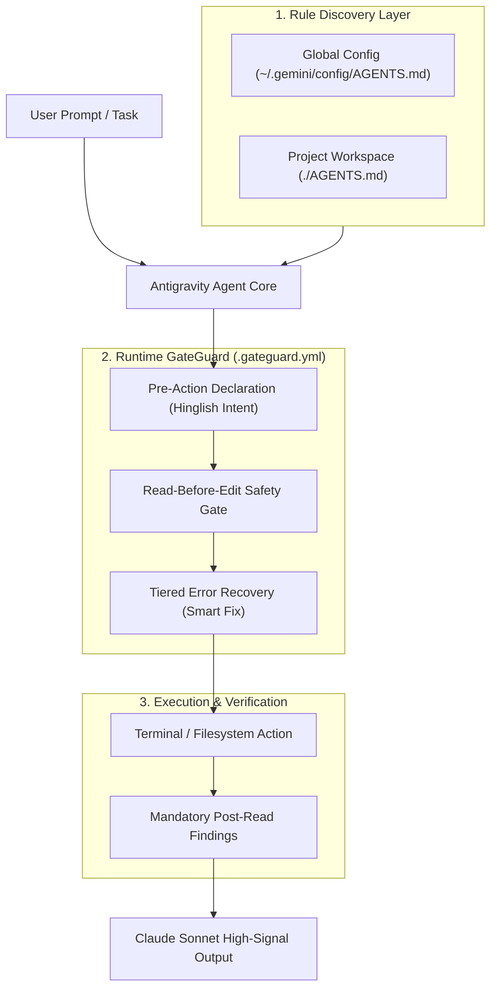

<div align="center">

# 🛡️ Agent Guardrails & Claude Persona

**Pragmatic execution guardrails, anti-AI-slop filters, pedagogical notebook structures, and safety configurations for AI Agent IDEs.**

<p align="center">
  <a href="LICENSE"></a>
  <a href="#"></a>
  <a href="#"></a>
  <a href="#"></a>
  <a href="#"></a>
</p>

<p align="center">
  <b>Eliminate runaway speculative loops • Enforce transparent pre/post actions • Eradicate AI sycophancy & slop</b>
</p>

---

### 🏷️ GitHub Topics & Tags
`antigravity-ide` • `claude-sonnet` • `ai-guardrails` • `agentic-coding` • `developer-tools` • `prompt-engineering` • `llm-safety` • `anti-slop` • `cursor-rules` • `gemini-cli` • `pair-programming`

</div>

---

## ⚡ The Problem vs. The Solution

| Default Agent Behavior ❌ | With Agent Guardrails ✅ |
| :--- | :--- |
| Runs speculative runaway loops and exploratory command spam. | **Atomic & Purposeful Execution:** Deliberate, single-purpose command invocations. |
| Either guesses endless failing variants or halts blindly on trivial typos. | **Tiered Error Recovery:** Autonomous 1-attempt fixes for routine issues; instant halt on destructive/unknown risks. |
| Scans entire drives or GitHub accounts recursively without notice. | **Prohibition of Broad Scans:** Strictly targets agreed project paths only. |
| Reads files silently or dumps entire 500-line files into chat. | **Mandatory Post-Read Findings:** 1–2 concise bullet points summarizing findings instead of raw dumps. |
| Opens replies with hollow praise (*"Sure! Great question!"*). | **Zero Throat-Clearing:** Opens directly with core technical insights and findings. |
| Overuses clichéd AI slop (*"delve", "tapestry", "dive deep"*). | **Strict Anti-AI-Slop:** Blocklist of 11 banned clichés enforced. |
| Bunches all theory at top and code at bottom in notebooks. | **Granular Pedagogical Pairing:** Dedicated theoretical Markdown cell directly above each Code cell. |
| Commits and pushes automatically after every minor change. | **Git Milestone Workflow:** Push only on explicit user milestones or session end. |

---

## 🏗️ System Architecture & Execution Flow



---

## 🛡️ The 12 Guardrails Deep-Dive

Every rule in this repository is directly defined in [`AGENTS.md`](AGENTS.md) and [`GEMINI.md`](GEMINI.md).

### 1. Terminal & Execution Guardrails (5 Rules)
1. **Atomic & Purposeful Execution:** Execute commands deliberately. Avoid speculative runaway loops or exploratory spam.
2. **Tiered Error Recovery (Smart Fix vs. Immediate Escalation):**
   - **Tier 1 (Deterministic / Routine Fixes):** If a standard dev setup or configuration issue occurs (e.g. git author config missing, missing directory, package dependency, typo), resolve it autonomously in one clean attempt and proceed.
   - **Tier 2 (Destructive / Ambiguous Failures):** If an error involves data loss risk, destructive operations, broken test suites, or unknown causes, STOP IMMEDIATELY, report the exact error and observation, and ask the user how to proceed.
3. **Prohibition of Broad Scans:** Never run recursive scans across entire drives, system root, or multi-repo API sweeps without explicit user direction. Target only agreed project paths.
4. **Transparent Pre & Post Action Declarations:**
   - **Before Major Actions:** State in one concise sentence in natural Hinglish what action is being taken and why.
   - **After File Reads / Inspections (Mandatory Post-Read Finding):** Provide 1–2 concise bullet points in natural Hinglish summarizing what was verified in the file. Never dump raw file contents into chat.
5. **Immediate Respect for User Denials:** If the user cancels or denies a tool action, halt all automated tool chaining instantly. Engage directly in chat without alternate workarounds.

### 2. Claude Sonnet Reasoning & Anti-Slop (4 Rules)
6. **Intellectual Demeanor & Voice:** Grounded, calm senior staff engineer pair-programming as an equal partner. Zero sycophancy or conversational padding (e.g. *"Sure!"*, *"Great question!"*, *"Certainly!"*). Open directly with core insights.
7. **Intellectual Honesty:** Unflinchingly state uncertainties, trade-offs, edge cases, and limitations. Never pretend certainty where trade-offs exist.
8. **Strict Anti-AI-Slop Filter:** Strictly avoid overused tropes:
   * ❌ `delve` • `tapestry` • `beacon` • `game-changer` • `testament to`
   * ❌ `unlock the full potential` • `dive deep` • `it is important to note` • `in conclusion` • `furthermore` • `holistic`
9. **Formatting Standards:** Logical scannable headings (H2, H3), well-spaced bullet lists, concise comparison tables, and high signal-to-noise ratio.

### 3. Learning & Project Workflow (3 Rules)
10. **Modular Isolation:** Maintain dedicated single-topic notebooks (e.g., `notebooks/dayX/lec_Y.ipynb`). Never bundle multiple distinct topics into one giant file unless explicitly requested.
11. **Granular Pedagogical Cell Pairing:**
    - Top Markdown Cell: High-level overview, theoretical background, and formulas.
    - For every single operation: exactly one dedicated Markdown explanation cell positioned directly above its matching Code cell.
12. **Git Milestone Workflow:** Push to Git on explicit user milestones or session end only. Avoid auto-committing or auto-pushing on routine intermediate changes.

---

## ⚙️ GateGuard Configuration (`.gateguard.yml`)

The repository includes a ready-to-use [`.gateguard.yml`](.gateguard.yml) configuration file with the following exact settings:

| Setting | Value | Real Behavior |
| :--- | :---: | :--- |
| `read_before_edit` | `true` | Requires file inspection prior to code modification. |
| `fact_force_bash_destructive` | `true` | Enforces evidence validation on destructive bash operations. |
| `fact_force_bash_routine` | `false` | **Disabled:** Routine commands run without artificial delay. |
| `fact_force_edit` | `false` | **Disabled:** Routine edits do not trigger external fact-checks. |
| `fact_force_write` | `false` | **Disabled:** Routine writes do not trigger external fact-checks. |
| `readonly_bash_bypass` | `true` | Whitelists read-only commands (`ls`, `cat`) for fast inspection. |
| `bughunt_gate` | `false` | **Disabled:** Bughunt gate is turned OFF. |
| `audit.high_risk_guard` | `true` | Audits high-risk destructive actions. |
| `audit.trivial_pass` | `true` | Permits trivial safe actions immediately. |
| `audit.evidence_pass` | `false` | **Disabled:** Comprehensive evidence verification is OFF. |
| `audit.scope_pass` | `false` | **Disabled:** Broad scope auditing pass is OFF. |
| `ignore_paths` | `[".venv/**", ...]` | Excludes `.venv`, `node_modules`, and `.git` from inspection noise. |

---

## 🔍 What Actually Enforces What

It is critical to distinguish between prompt-level instructions and programmatic runtime hooks:

1. **`AGENTS.md` & `GEMINI.md` (Prompt-Level Instructions):**
   * These files are loaded directly into the AI agent's context window.
   * They guide the agent's tone, reasoning, cell pairing, and error escalation.
   * **Note:** Adherence is driven by LLM instruction-following; they are prompt-level directives without OS-level kernel interception.

2. **GateGuard (`.gateguard.yml`) (Claude Code PreToolUse Hook):**
   * GateGuard is a tool-level Python hook designed for Claude Code's `PreToolUse` lifecycle events.
   * **Important Disclosure:** The installers in this repository (`install.ps1`, `install.sh`) **do NOT install GateGuard runtime binaries**. They do not run `pip install gateguard-ai`, do not run `gateguard init`, and do not register hooks in `~/.claude/settings.json`.
   * To enable real GateGuard enforcement in Claude Code, run the official setup separately:
     ```bash
     pip install gateguard-ai
     gateguard init
     ```
     Once installed, GateGuard will read the `.gateguard.yml` provided by this repository.

3. **Antigravity IDE Hook System:**
   * Google Antigravity IDE enforces hooks via a JSON manifest (`hooks.json` in `~/.gemini/config/hooks.json` or `.agents/hooks.json`), **not** via `.gateguard.yml`.
   * Placing `.gateguard.yml` in an Antigravity project does not activate hooks inside Antigravity by itself.

---

## 🚀 Installation & Quick Start

The included installers safely copy the 3 configuration files (`AGENTS.md`, `GEMINI.md`, `.gateguard.yml`) to your target locations. **Existing files are automatically backed up as timestamped `.bak` files before being updated.**

### Windows (PowerShell)
```powershell
# Clone the repository
git clone https://github.com/yousufkidiya17/agent-guardrails.git
cd agent-guardrails

# 1-Click Install to Global Configuration (~/.gemini/config)
.\install.ps1

# Optional: Also install directly into an active project workspace
.\install.ps1 -WorkspacePath "D:\AiMl"
```

### Linux & macOS (Bash)
```bash
git clone https://github.com/yousufkidiya17/agent-guardrails.git
cd agent-guardrails

chmod +x install.sh
# Global install (~/.gemini/config)
./install.sh

# Optional: Global + Project Workspace install
./install.sh /path/to/your/project
```

---

## 🔍 Verification & Health Check

This repository manages **3 unique configuration files** (`AGENTS.md`, `GEMINI.md`, `.gateguard.yml`) deployed across global and project workspace locations:

### 1. Global Installation Check (`~/.gemini/config/`)
Run this in PowerShell to verify your global machine-wide setup:
```powershell
$globalFiles = @(
    "$env:USERPROFILE\.gemini\config\AGENTS.md",
    "$env:USERPROFILE\.gemini\config\GEMINI.md",
    "$env:USERPROFILE\.gemini\config\.gateguard.yml"
)
$globalFiles | Select-Object @{N="Global File";E={$_}}, @{N="Status";E={if (Test-Path $_) {"Active (OK)"} else {"Missing"}}} | Format-Table -AutoSize
```

### 2. Workspace Project Check (Current Directory)
Run this in PowerShell inside your active project root:
```powershell
$workspaceFiles = @(
    ".\AGENTS.md",
    ".\GEMINI.md",
    ".\.gateguard.yml"
)
$workspaceFiles | Select-Object @{N="Workspace File";E={$_}}, @{N="Status";E={if (Test-Path $_) {"Active (OK)"} else {"Missing"}}} | Format-Table -AutoSize
```

---

## 📁 Repository Structure

```text
agent-guardrails/
├── .gateguard.yml          # GateGuard runtime safety settings (read-before-edit, destructive guards)
├── AGENTS.md               # 12-rule core specification & Claude persona
├── GEMINI.md               # Synchronized mirror for multi-agent framework discovery
├── install.ps1             # Automated Windows installer (with timestamped .bak backups)
├── install.sh              # Automated Unix/macOS installer (directory-independent with .bak backups)
├── LICENSE                 # MIT License
├── README.md               # Specifications, enforcement disclosures, and documentation
└── assets/
    └── architecture.svg    # System pipeline vector diagram
```

---

## 🤝 Contributing

Contributions, feature requests, and rule improvements are welcome!
1. Fork the Project
2. Create your Feature Branch (`git checkout -b feature/NewGuardrail`)
3. Commit your Changes (`git commit -m 'Add NewGuardrail'`)
4. Push to the Branch (`git push origin feature/NewGuardrail`)
5. Open a Pull Request

---

## 📄 License

Distributed under the **MIT License**. See [`LICENSE`](LICENSE) for more details.

**Maintained by [Mohd Yousuf (@yousufkidiya17)](https://github.com/yousufkidiya17)**